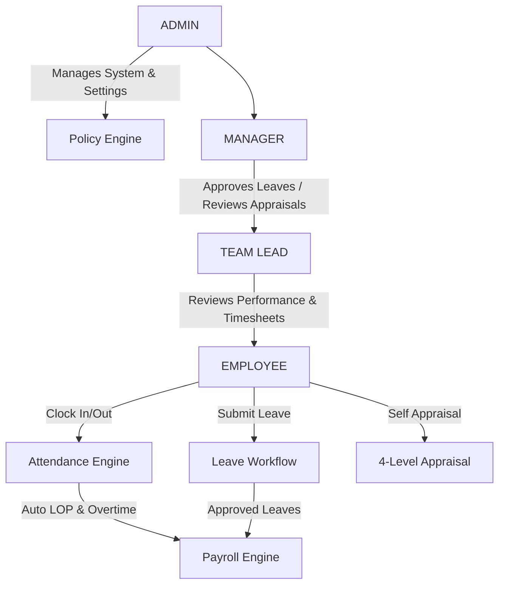

# ADAMMA HRMS — Complete Full-Stack Engineering Specification & Implementation Blueprint
**Document Version:** 1.0.0  
**Domain:** Enterprise Human Resource Management System (HRMS)  
**Stack:** MongoDB, Express.js, React (TypeScript), Node.js (MERN) + Tailwind CSS + Redis/BullMQ

---

## 1. System Overview & Architectural Topology

The **ADAMMA HRMS** is an enterprise-grade, role-hierarchical human resource management system. It enforces a strict structural chain of command:
$$\text{ADMIN} \longrightarrow \text{MANAGER} \longrightarrow \text{TL (Team Lead)} \longrightarrow \text{EMPLOYEE}$$

### Architectural Highlights
- **Strict Role-Based Access Control (RBAC):** Hierarchical reporting structure where high-level supervisors can act on behalf of, review, or overwrite actions of lower-level reporting staff.
- **Data-Driven Policy Engine:** Dynamic thresholds (such as shift timings, late markers, Saturday off configurations, break locking hours, and leave limits) are stored inside a versioned `PolicySettings` database collection instead of being hardcoded in application logic.
- **Robust Verification Pipeline:** Includes background jobs for automated LOP calculation, monthly leave accruals, NCNS detection, and appraisal status transitions.



---

## 2. Project Skeleton & Directory Topology

The project is structured as a monorepo featuring static typing via TypeScript on both the client and server.

```text
adamma-hrms/
├── backend/
│   ├── src/
│   │   ├── config/             # DB connections, Redis setup, Mailer setup
│   │   ├── controllers/        # Request handlers (auth, attendance, leaves, etc.)
│   │   ├── middlewares/        # Authentication, dynamic RBAC checks, rate limiters
│   │   ├── models/             # Mongoose schemas & TypeScript type definitions
│   │   ├── routes/             # Express routes mapped to controllers
│   │   ├── services/           # Core domain services (AttendanceEngine, AppraisalEngine, etc.)
│   │   ├── workers/            # BullMQ workers for async queues and schedulers
│   │   ├── seeds/              # Initial seed scripts (2026 holidays, policies, admin user)
│   │   └── app.ts              # Express application bootstrap
│   ├── tests/                  # Jest integration and unit test suites
│   ├── package.json
│   ├── tsconfig.json
│   └── Dockerfile
├── frontend/
│   ├── src/
│   │   ├── assets/             # Images, static vectors
│   │   ├── components/         # Reusable UI components (buttons, input grids, layout shells)
│   │   ├── context/            # Global context (Auth, Notifications)
│   │   ├── hooks/              # React Query hooks for state synchrony
│   │   ├── pages/              # View pages (Dashboard, Appraisal, Leave, Attendance, Settings)
│   │   ├── store/              # Zustand lightweight global state hooks
│   │   ├── utils/              # Calculation utilities and dynamic formula helpers
│   │   ├── App.tsx             # React App root with Router definition
│   │   └── index.css           # Tailwind design directives
│   ├── package.json
│   ├── tsconfig.json
│   ├── tailwind.config.js
│   └── Dockerfile
├── docker-compose.yml          # Local infrastructure setup (App, MongoDB, Redis)
└── README.md
```

---

## 3. MongoDB Collections & Mongoose Schemas

All collections enforce database-level indexes, strict constraints, and schema validations.

### 3.1 Mongoose Models & Schemas

#### User Schema
```typescript
import { Schema, model, Document } from 'mongoose';

export interface IUser extends Document {
  name: string;
  email: string;
  mobile: string;
  role: 'ADMIN' | 'MANAGER' | 'TL' | 'EMPLOYEE';
  managerId?: Schema.Types.ObjectId;
  tlId?: Schema.Types.ObjectId;
  dateOfJoining: Date;
  status: 'PROBATION' | 'CONFIRMED' | 'TERMINATED' | 'SUSPENDED';
  probationEnd: Date;
  bankDetails: {
    accountNumber: string;
    ifscCode: string;
    bankName: string;
  };
  salary: {
    baseSalary: number;
    allowances: number;
    retentionAmount: number; // Retention hold amount
  };
  emergencyContact: {
    name: string;
    relation: string;
    phone: string;
  };
  isConfirmed: boolean;
  twoFactorSecret?: string;
  is2FAEnabled: boolean;
  documents: { type: string; url: string; uploadedAt: Date }[];
}

const UserSchema = new Schema<IUser>({
  name: { type: String, required: true },
  email: { type: String, required: true, unique: true, index: true },
  mobile: { type: String, required: true },
  role: { type: String, enum: ['ADMIN', 'MANAGER', 'TL', 'EMPLOYEE'], required: true, index: true },
  managerId: { type: Schema.Types.ObjectId, ref: 'User', index: true },
  tlId: { type: Schema.Types.ObjectId, ref: 'User', index: true },
  dateOfJoining: { type: Date, required: true },
  status: { type: String, enum: ['PROBATION', 'CONFIRMED', 'TERMINATED', 'SUSPENDED'], required: true },
  probationEnd: { type: Date, required: true },
  bankDetails: {
    accountNumber: { type: String, required: true },
    ifscCode: { type: String, required: true },
    bankName: { type: String, required: true }
  },
  salary: {
    baseSalary: { type: Number, required: true },
    allowances: { type: Number, required: true },
    retentionAmount: { type: Number, default: 0 }
  },
  emergencyContact: {
    name: { type: String, required: true },
    relation: { type: String, required: true },
    phone: { type: String, required: true }
  },
  isConfirmed: { type: Boolean, default: false },
  twoFactorSecret: { type: String },
  is2FAEnabled: { type: Boolean, default: false },
  documents: [{
    type: { type: String, required: true },
    url: { type: String, required: true },
    uploadedAt: { type: Date, default: Date.now }
  }]
}, { timestamps: true });

export const UserModel = model<IUser>('User', UserSchema);
```

#### Attendance Schema
```typescript
export interface IAttendance extends Document {
  userId: Schema.Types.ObjectId;
  date: Date;
  clockIn?: Date;
  clockOut?: Date;
  workingHours: number; // in decimal hours
  isLate: boolean;
  lateMinutes: number;
  breakSlots: { outTime: Date; inTime?: Date; durationMinutes?: number }[];
  isLocked: boolean; // locked for breaks
  autoMarked: boolean; // marked NCNS or ABSENT automatically
  status: 'PRESENT' | 'ABSENT' | 'NCNS' | 'WEEK_OFF' | 'HOLIDAY';
  source: 'WEB' | 'BIOMETRIC' | 'SYSTEM';
  notes?: string;
}

const AttendanceSchema = new Schema<IAttendance>({
  userId: { type: Schema.Types.ObjectId, ref: 'User', required: true, index: true },
  date: { type: Date, required: true, index: true },
  clockIn: { type: Date },
  clockOut: { type: Date },
  workingHours: { type: Number, default: 0 },
  isLate: { type: Boolean, default: false },
  lateMinutes: { type: Number, default: 0 },
  breakSlots: [{
    outTime: { type: Date, required: true },
    inTime: { type: Date },
    durationMinutes: { type: Number }
  }],
  isLocked: { type: Boolean, default: false },
  autoMarked: { type: Boolean, default: false },
  status: { type: String, enum: ['PRESENT', 'ABSENT', 'NCNS', 'WEEK_OFF', 'HOLIDAY'], required: true },
  source: { type: String, enum: ['WEB', 'BIOMETRIC', 'SYSTEM'], default: 'WEB' },
  notes: { type: String }
}, { timestamps: true });

AttendanceSchema.index({ userId: 1, date: 1 }, { unique: true });
export const AttendanceModel = model<IAttendance>('Attendance', AttendanceSchema);
```

#### Leave Schema
```typescript
export interface ILeave extends Document {
  userId: Schema.Types.ObjectId;
  type: 'EL' | 'CL' | 'SL' | 'COMP_OFF' | 'LOP' | 'MATERNITY' | 'PATERNITY' | 'BEREAVEMENT';
  startDate: Date;
  endDate: Date;
  days: number;
  status: 'PENDING' | 'TL_APPROVED' | 'APPROVED' | 'REJECTED' | 'RETURNED_TO_USER';
  appliedAt: Date;
  approvedBy: { role: string; userId: Schema.Types.ObjectId; date: Date }[];
  documents: string[]; // urls for medical proof / SL requirements
  remarks?: string;
  compOffEarnedFrom?: Date; // Reference to the worked Saturday if type is COMP_OFF
}

const LeaveSchema = new Schema<ILeave>({
  userId: { type: Schema.Types.ObjectId, ref: 'User', required: true, index: true },
  type: { type: String, enum: ['EL', 'CL', 'SL', 'COMP_OFF', 'LOP', 'MATERNITY', 'PATERNITY', 'BEREAVEMENT'], required: true },
  startDate: { type: Date, required: true },
  endDate: { type: Date, required: true },
  days: { type: Number, required: true },
  status: { type: String, enum: ['PENDING', 'TL_APPROVED', 'APPROVED', 'REJECTED', 'RETURNED_TO_USER'], default: 'PENDING' },
  appliedAt: { type: Date, default: Date.now },
  approvedBy: [{
    role: { type: String, required: true },
    userId: { type: Schema.Types.ObjectId, ref: 'User', required: true },
    date: { type: Date, default: Date.now }
  }],
  documents: [{ type: String }],
  remarks: { type: String },
  compOffEarnedFrom: { type: Date }
}, { timestamps: true });

export const LeaveModel = model<ILeave>('Leave', LeaveSchema);
```

#### LeavePolicy, Holiday, and PolicySettings Schemas
```typescript
// LeavePolicy Schema
export const LeavePolicySchema = new Schema({
  type: { type: String, required: true, unique: true },
  accrualRateMonthly: { type: Number, required: true }, // e.g. 1.25 for EL (15 per year)
  maxCarryForward: { type: Number, default: 0 },
  requiresProbationCompletion: { type: Boolean, default: false },
  requiresDocumentationAfterDays: { type: Number, default: 0 }, // e.g. SL needs cert if > 3 days
  allowClubbingWith: [{ type: String }]
});

// Holiday Schema
export const HolidaySchema = new Schema({
  name: { type: String, required: true },
  date: { type: Date, required: true, unique: true },
  isOptional: { type: Boolean, default: false }
});

// PolicySettings Schema (Data-driven logic rules)
export const PolicySettingsSchema = new Schema({
  version: { type: Number, default: 1 },
  shiftStartTime: { type: String, default: "09:30" }, // late thresholds
  shiftEndTime: { type: String, default: "18:30" },
  lateAllowanceDays: { type: Number, default: 3 }, // days allowed late monthly without deduction
  lateMinutesCap: { type: Number, default: 50 }, // max minutes late aggregate before auto LOP
  workingSaturdays: [{ type: Number }], // [1, 3, 5]
  ncnsThresholdConsecutiveDays: { type: Number, default: 2 },
  gracePeriodMinutes: { type: Number, default: 15 }, // late margin
  breakWindows: [{ startTime: String, endTime: String }]
}, { timestamps: true });
```

#### AppraisalRecord Schema
```typescript
export interface IAppraisalRecord extends Document {
  userId: Schema.Types.ObjectId;
  cycleId: Schema.Types.ObjectId;
  status: 'DRAFT' | 'SELF_SUBMITTED' | 'TL_REVIEWED' | 'MANAGER_REVIEWED' | 'ADMIN_REVIEWED' | 'COMPLETED';
  ratings: {
    employee: { scores: number[]; feedback: string };
    tl: { scores: number[]; feedback: string };
    manager: { scores: number[]; feedback: string };
    admin: { scores: number[]; feedback: string };
  };
  sectionWeights: number[]; // e.g., length 8, summing to 100
  finalAggregatedScore?: number;
  systemRecommendation?: 'PROMOTION' | 'HIKE_A' | 'HIKE_B' | 'PIP' | 'RETAIN';
  history: { fromStatus: string; toStatus: string; timestamp: Date; actor: Schema.Types.ObjectId; comments?: string }[];
}

const AppraisalRecordSchema = new Schema<IAppraisalRecord>({
  userId: { type: Schema.Types.ObjectId, ref: 'User', required: true, index: true },
  cycleId: { type: Schema.Types.ObjectId, required: true },
  status: { type: String, enum: ['DRAFT', 'SELF_SUBMITTED', 'TL_REVIEWED', 'MANAGER_REVIEWED', 'ADMIN_REVIEWED', 'COMPLETED'], default: 'DRAFT' },
  ratings: {
    employee: { scores: [{ type: Number }], feedback: { type: String } },
    tl: { scores: [{ type: Number }], feedback: { type: String } },
    manager: { scores: [{ type: Number }], feedback: { type: String } },
    admin: { scores: [{ type: Number }], feedback: { type: String } }
  },
  sectionWeights: { type: [{ type: Number }], required: true },
  finalAggregatedScore: { type: Number },
  systemRecommendation: { type: String, enum: ['PROMOTION', 'HIKE_A', 'HIKE_B', 'PIP', 'RETAIN'] },
  history: [{
    fromStatus: { type: String },
    toStatus: { type: String },
    timestamp: { type: Date, default: Date.now },
    actor: { type: Schema.Types.ObjectId, ref: 'User' },
    comments: { type: String }
  }]
}, { timestamps: true });

export const AppraisalRecordModel = model<IAppraisalRecord>('AppraisalRecord', AppraisalRecordSchema);
```

#### SalaryRule & PayrollRecord Schema
```typescript
// SalaryRule Schema
export const SalaryRuleSchema = new Schema({
  name: { type: String, required: true },
  type: { type: String, enum: ['EARNING', 'DEDUCTION'], required: true },
  calculationFormula: { type: String, required: true }, // e.g., "baseSalary * 0.12"
  isActive: { type: Boolean, default: true }
});

// PayrollRecord Schema
export const PayrollRecordSchema = new Schema({
  userId: { type: Schema.Types.ObjectId, ref: 'User', required: true, index: true },
  monthYear: { type: String, required: true, index: true }, // "05-2026"
  basePaid: { type: Number, required: true },
  allowances: { type: Number, default: 0 },
  deductions: { type: Number, default: 0 },
  lopDays: { type: Number, default: 0 },
  retentionHeld: { type: Number, default: 0 },
  netPayout: { type: Number, required: true },
  status: { type: String, enum: ['DRAFT', 'APPROVED', 'PAID'], default: 'DRAFT' },
  payoutDate: { type: Date },
  auditLog: [{ action: String, timestamp: Date, actor: Schema.Types.ObjectId }]
}, { timestamps: true });
```

#### NCNSRecord Schema
```typescript
export const NCNSRecordSchema = new Schema({
  userId: { type: Schema.Types.ObjectId, ref: 'User', required: true, index: true },
  dateOfOccurrence: { type: Date, required: true },
  escalationStage: { type: Number, default: 1 }, // 1: Verbal, 2: Written Warning, 3: Account Lock, 4: Terminated
  actionTaken: { type: String },
  resolved: { type: Boolean, default: false },
  resolvedBy: { type: Schema.Types.ObjectId, ref: 'User' },
  resolutionNotes: { type: String }
}, { timestamps: true });
```

#### AuditLog Schema
```typescript
export const AuditLogSchema = new Schema({
  userId: { type: Schema.Types.ObjectId, ref: 'User', index: true },
  event: { type: String, required: true, index: true }, // "USER_LOGIN", "LEAVE_APPROVED", "POLICY_CHANGE"
  description: { type: String, required: true },
  metadata: { type: Schema.Types.Mixed }, // Stores old/new value diffs
  ipAddress: { type: String },
  userAgent: { type: String }
}, { timestamps: true });
```

---

### 3.2 Database JSON Seed Documents

#### User
```json
{
  "_id": "60d5ec49f3e46c24f8d5a101",
  "name": "Arjun Sharma",
  "email": "employee.arjun@adamma.in",
  "mobile": "+919876543210",
  "role": "EMPLOYEE",
  "managerId": "60d5ec49f3e46c24f8d5a102",
  "tlId": "60d5ec49f3e46c24f8d5a103",
  "dateOfJoining": "2026-01-05T00:00:00.000Z",
  "status": "PROBATION",
  "probationEnd": "2026-07-05T00:00:00.000Z",
  "bankDetails": {
    "accountNumber": "912010043829103",
    "ifscCode": "UTIB0000004",
    "bankName": "Axis Bank Ltd"
  },
  "salary": {
    "baseSalary": 45000,
    "allowances": 15000,
    "retentionAmount": 5000
  },
  "emergencyContact": {
    "name": "Nisha Sharma",
    "relation": "Spouse",
    "phone": "+919876543211"
  },
  "isConfirmed": false,
  "is2FAEnabled": false,
  "documents": []
}
```

#### PolicySettings
```json
{
  "_id": "60d5ec49f3e46c24f8d5a200",
  "version": 1,
  "shiftStartTime": "09:30",
  "shiftEndTime": "18:30",
  "lateAllowanceDays": 3,
  "lateMinutesCap": 50,
  "workingSaturdays": [1, 3, 5],
  "ncnsThresholdConsecutiveDays": 2,
  "gracePeriodMinutes": 15,
  "breakWindows": [
    { "startTime": "13:00", "endTime": "14:00" },
    { "startTime": "16:00", "endTime": "16:30" }
  ]
}
```

---

## 4. OpenAPI 3.0 API Directory

Standardized JSON Response Body shape on errors:
```json
{
  "code": "ERROR_CODE_STRING",
  "message": "User-friendly descriptive error message.",
  "details": {}
}
```

| Path | Method | Auth Required | Payload Example | Success Response (200/201) | Error Handled |
|:---|:---|:---|:---|:---|:---|
| `/api/auth/login` | `POST` | Public | `{"email":"emp@ad.in","pass":"123"}` | `{"token":"JWT_HASH","2fa":false}` | `401: INVALID_CREDENTIALS` |
| `/api/auth/2fa-setup`| `POST` | Authenticated | `{}` | `{"qrCode":"DATA_URI","secret":"KEY"}` | `400: ALREADY_ENABLED` |
| `/api/attendance/mark`| `POST` | `EMPLOYEE` | `{"action":"CLOCK_IN","lat":12.97}` | `{"status":"PRESENT","clockIn":"ISO"}`| `400: ALREADY_CLOCKED_IN` |
| `/api/attendance/break`| `POST` | `EMPLOYEE` | `{"action":"OUT"}` | `{"locked":true,"outTime":"ISO"}` | `400: NOT_CLOCKED_IN` |
| `/api/leaves/apply` | `POST` | `EMPLOYEE` | `{"type":"CL","start":"2026-06-01","end":"2026-06-02","days":2}` | `{"leaveId":"ID","status":"PENDING"}`| `400: INSUFFICIENT_BALANCE` |
| `/api/leaves/:id/approve` | `POST`| `TL`, `MANAGER` | `{"remarks":"Approved for execution"}`| `{"leaveId":"ID","status":"APPROVED"}`| `403: HIERARCHY_VIOLATION` |
| `/api/appraisal/submit`| `POST` | `EMPLOYEE` | `{"ratings":[4,5,4,4,5,4,4,5],"feed":"Done"}`| `{"appraisalId":"ID","status":"SUBMITTED"}`| `400: PHASE_LOCKED` |
| `/api/appraisal/:id/tl-review`| `POST`| `TL` | `{"ratings":[4,4,4,4,4,4,4,4],"feed":"Good"}`| `{"status":"TL_REVIEWED"}` | `403: UNAUTHORIZED` |
| `/api/payroll/generate`| `GET` | `ADMIN` | None | `{"status":"GENERATED","payoutsCount":45}`| `500: PAYROLL_RUN_FAILED` |
| `/api/admin/policy` | `PUT` | `ADMIN` | `{"shiftStartTime":"09:15","lateAllowanceDays":2}`| `{"version":2,"updated":true}` | `400: INVALID_SETTINGS` |

---

## 5. RBAC & Access Matrix Blueprint

### 5.1 Screen Access Matrix

| Feature Screen / Route | ADMIN | MANAGER | TL | EMPLOYEE |
|:---|:---:|:---:|:---:|:---:|
| **Appraisal Setup & Calibration** | R/W | R | R | N/A |
| **Policy Matrix Configuration** | R/W | R | R | N/A |
| **All Company Attendance Dashboard** | R/W | R | R (Team Only)| N/A |
| **Self Attendance Marking / History** | R/W | R/W | R/W | R/W |
| **Leave Approval Queue** | R/W | R/W | R/W (Team Only)| N/A |
| **Appraisal Form Submission** | R/W | R/W | R/W | R/W |
| **Appraisal Finalization & Action** | R/W | N/A | N/A | N/A |
| **Company Directory & Document Templates**| R/W | R | R | R |

*Note: Administrative roles retain system-wide toggle abilities to temporarily modify rights (e.g. enabling a TL to temporarily approve leaves on behalf of a Manager during planned leave).*

### 5.2 Node.js/TypeScript RBAC Middleware

```typescript
import { Request, Response, NextFunction } from 'express';
import jwt from 'jsonwebtoken';

export interface AuthenticatedRequest extends Request {
  user?: {
    id: string;
    role: 'ADMIN' | 'MANAGER' | 'TL' | 'EMPLOYEE';
    permissions: string[];
    managerId?: string;
  };
}

export const requirePermission = (requiredPermission: string) => {
  return (req: AuthenticatedRequest, res: Response, next: NextFunction) => {
    try {
      const authHeader = req.headers.authorization;
      if (!authHeader || !authHeader.startsWith('Bearer ')) {
        return res.status(401).json({ code: 'UNAUTHORIZED', message: 'Missing authentication token.' });
      }

      const token = authHeader.split(' ')[1];
      const decoded = jwt.verify(token, process.env.JWT_SECRET as string) as any;
      req.user = decoded;

      // Admin bypasses checks
      if (req.user?.role === 'ADMIN') {
        return next();
      }

      const hasPermission = req.user?.permissions.includes(requiredPermission);
      if (!hasPermission) {
        return res.status(403).json({ 
          code: 'FORBIDDEN', 
          message: 'Insufficient security privileges to access this system route.' 
        });
      }

      next();
    } catch (error) {
      return res.status(401).json({ code: 'INVALID_TOKEN', message: 'Token is invalid or expired.' });
    }
  };
};
```

---

## 6. Frontend Layout & Page Map

The frontend dashboard experience is highly contextualized, rendering custom layouts built using curated **Tailwind CSS HSL configurations** rather than standard default colors.

### 6.1 Tailwind Configuration Details (`tailwind.config.js`)
```javascript
module.exports = {
  theme: {
    extend: {
      colors: {
        brand: {
          dark: 'hsl(222, 47%, 11%)', // Deep Slate Indigo
          primary: 'hsl(217, 91%, 60%)', // Electric Premium Blue
          accent: 'hsl(142, 71%, 45%)', // High-end Mint Emerald
          warning: 'hsl(38, 92%, 50%)', // Goldenrod Amber
          danger: 'hsl(350, 89%, 60%)' // Crimson Red
        }
      },
      fontFamily: {
        sans: ['Outfit', 'Inter', 'sans-serif']
      }
    }
  }
}
```

### 6.2 Key Frontend Components

#### A. Interactive Glassmorphic Clock-In Component (`ClockPanel.tsx`)
```tsx
import React, { useState } from 'react';

interface ClockPanelProps {
  onMarkAttendance: (action: 'IN' | 'OUT') => void;
  isClockedIn: boolean;
  lateMinutes: number;
}

export const ClockPanel: React.FC<ClockPanelProps> = ({ onMarkAttendance, isClockedIn, lateMinutes }) => {
  const [loading, setLoading] = useState(false);

  return (
    <div className="p-8 rounded-2xl bg-white/10 backdrop-blur-md border border-white/20 shadow-2xl text-white">
      <h3 className="text-xl font-bold tracking-tight mb-2">Shift Clock</h3>
      <p className="text-sm text-gray-300 mb-6">Standard Hours: 09:30 AM — 06:30 PM</p>
      
      {lateMinutes > 0 && (
        <div className="mb-6 p-3 rounded-lg bg-brand-danger/20 border border-brand-danger/30 text-xs text-red-200">
          ⚠️ Running {lateMinutes} minutes late this morning.
        </div>
      )}

      <button
        onClick={() => { setLoading(true); onMarkAttendance(isClockedIn ? 'OUT' : 'IN'); setLoading(false); }}
        className={`w-full py-4 rounded-xl font-bold transition-all transform active:scale-95 duration-200 ${
          isClockedIn 
            ? 'bg-gradient-to-r from-brand-danger to-red-500 hover:shadow-brand-danger/30 hover:shadow-lg' 
            : 'bg-gradient-to-r from-brand-primary to-blue-500 hover:shadow-brand-primary/30 hover:shadow-lg'
        }`}
      >
        {isClockedIn ? 'Punch Out' : 'Punch In'}
      </button>
    </div>
  );
};
```

---

## 7. Business Logic & Domain Code Pseudocode

### 7.1 Attendance Engine (Late Login & Weekend Offs)

```javascript
/**
 * Processes daily check-in logic
 * Implements grace period, working Saturday detection (1st, 3rd, 5th) and marks status.
 */
async function processClockIn(userId, timestamp, policySettings) {
  const checkInTime = new Date(timestamp);
  const checkInStr = checkInTime.toTimeString().split(' ')[0].substring(0, 5); // "HH:MM"
  
  const [shiftHours, shiftMins] = policySettings.shiftStartTime.split(':').map(Number);
  const [inputHours, inputMins] = checkInStr.split(':').map(Number);
  
  const graceLimitMinutes = shiftHours * 60 + shiftMins + policySettings.gracePeriodMinutes;
  const inputTotalMinutes = inputHours * 60 + inputMins;

  let isLate = false;
  let lateMinutes = 0;

  if (inputTotalMinutes > graceLimitMinutes) {
    isLate = true;
    lateMinutes = inputTotalMinutes - (shiftHours * 60 + shiftMins);
  }

  // Determine working Saturday
  const isWeekendOff = evaluateWeekendOff(checkInTime, policySettings.workingSaturdays);
  const status = isWeekendOff ? 'WEEK_OFF' : 'PRESENT';

  return {
    isLate,
    lateMinutes,
    status,
    isWeekendOff
  };
}

function evaluateWeekendOff(date, workingSaturdays) {
  const day = date.getDay(); // 0: Sunday, 6: Saturday
  if (day === 0) return true; // Sundays always off
  if (day === 6) {
    const dayOfMonth = date.getDate();
    const weekNumber = Math.ceil(dayOfMonth / 7);
    // If not in our active working list (e.g. 1st, 3rd, 5th), it's off
    return !workingSaturdays.includes(weekNumber);
  }
  return false;
}
```

### 7.2 Appraisal Score Aggregator

Implements a 4-level appraisal cycle. The weighted ratings matrix consists of 8 core sections:
1. Job Knowledge (12.5%)
2. Execution Quality (12.5%)
3. Attendance Integrity (12.5%)
4. Discipline & Integrity (12.5%)
5. Technical Proficiency (12.5%)
6. Process Adherence (12.5%)
7. Adaptability & Teamwork (12.5%)
8. Communication Skills (12.5%)

Tiers are weighted as follows:
- **Employee Self:** 30%
- **TL:** 30%
- **Manager:** 30%
- **Admin:** 10%

```javascript
/**
 * Aggregates multi-level score mapping to standard organizational options.
 */
function calculateFinalAppraisalScore(record) {
  const tiers = ['employee', 'tl', 'manager', 'admin'];
  const tierWeights = { employee: 0.30, tl: 0.30, manager: 0.30, admin: 0.10 };
  const sectionWeight = 12.5; // Each of the 8 sections represents 12.5% of a tier

  let totalWeightedScore = 0;

  tiers.forEach(tier => {
    const scores = record.ratings[tier].scores; // Array of 8 integers (1 to 5 scale)
    if (!scores || scores.length !== 8) return;

    let tierRawSum = scores.reduce((sum, score) => sum + score, 0); // Out of 40
    let tierPercentage = (tierRawSum / 40) * 100; // Normalised to scale of 100
    
    totalWeightedScore += tierPercentage * tierWeights[tier];
  });

  // Calculate final actions
  let action = 'RETAIN';
  if (totalWeightedScore >= 90) action = 'PROMOTION';
  else if (totalWeightedScore >= 75) action = 'HIKE_A';
  else if (totalWeightedScore >= 60) action = 'HIKE_B';
  else if (totalWeightedScore < 45) action = 'PIP';

  return {
    score: parseFloat(totalWeightedScore.toFixed(2)),
    recommendedAction: action
  };
}
```

---

## 8. Background Workers & Queue Management

The system uses **BullMQ** (powered by Redis) to schedule tasks, process notifications, and perform daily validations.

### 8.1 Active Schedulers (Cron Mapping)

| Background Job Class | Cron Expression | Schedule Frequency | Objective | Queue Payload Contract |
|:---|:---|:---|:---|:---|
| `DailyAttendanceAggregator` | `59 23 * * *` | Daily at 11:59 PM | Scans uncompleted clocks, marks ABSENT/NCNS, and runs late minute LOP checks. | `{ "runDate": "ISO_DATE", "dryRun": false }` |
| `MonthlyLeaveAccruer` | `0 3 1 * *` | 1st of every month | Accrues CL (1 day) and EL (1.25 days) based on confirmation/probation state. | `{ "year": 2026, "month": 6 }` |
| `CompOffExpiryMonitor` | `0 4 * * *` | Daily at 04:00 AM | Checks earned compensatory leaves and expires them past the 3-month mark. | `{}` |
| `PayrollProcessor` | `0 2 4 * *` | 4th of every month | Generates draft payslips applying hourly LOP deductions. | `{ "billingPeriod": "05-2026" }` |
| `NCNSNotificationTrigger`| `0 10 * * *` | Daily at 10:00 AM | Scans consecutive missing clock-ins, fires warning escalations. | `{}` |

### 8.2 Sample BullMQ Worker Hook

```typescript
import { Worker, Job } from 'bullmq';
import { AttendanceModel } from '../models/Attendance';
import { UserModel } from '../models/User';

export const dailyAttendanceWorker = new Worker('AttendanceQueue', async (job: Job) => {
  if (job.name === 'DailyAggregate') {
    const today = new Date();
    today.setHours(0, 0, 0, 0);

    const activeUsers = await UserModel.find({ status: { $in: ['PROBATION', 'CONFIRMED'] } });

    for (const user of activeUsers) {
      const record = await AttendanceModel.findOne({ userId: user._id, date: today });
      if (!record) {
        // Create auto-absent record
        await AttendanceModel.create({
          userId: user._id,
          date: today,
          status: 'ABSENT',
          autoMarked: true,
          source: 'SYSTEM'
        });
      }
    }
  }
}, { connection: { host: process.env.REDIS_HOST || '127.0.0.1', port: 6379 } });
```

---

## 9. Seed Data Matrix (Sections A-J & 2026 Calendar)

### 9.1 2026 Standard Gazetted Holidays Seed Data (IST)

```json
[
  { "name": "Republic Day", "date": "2026-01-26T00:00:00.000Z", "isOptional": false },
  { "name": "Maha Shivratri", "date": "2026-02-15T00:00:00.000Z", "isOptional": true },
  { "name": "Holi", "date": "2026-03-04T00:00:00.000Z", "isOptional": false },
  { "name": "Good Friday", "date": "2026-04-03T00:00:00.000Z", "isOptional": false },
  { "name": "Eid-ul-Fitr", "date": "2026-03-20T00:00:00.000Z", "isOptional": false },
  { "name": "Independence Day", "date": "2026-08-15T00:00:00.000Z", "isOptional": false },
  { "name": "Gandhi Jayanti", "date": "2026-10-02T00:00:00.000Z", "isOptional": false },
  { "name": "Diwali (Deepavali)", "date": "2026-11-08T00:00:00.000Z", "isOptional": false },
  { "name": "Guru Nanak Jayanti", "date": "2026-11-24T00:00:00.000Z", "isOptional": true },
  { "name": "Christmas Day", "date": "2026-12-25T00:00:00.000Z", "isOptional": false }
]
```

### 9.2 Initial Database Seed Script (`seed.ts`)

```typescript
import mongoose from 'mongoose';
import { UserModel } from './backend/src/models/User';
import bcrypt from 'bcrypt';

async function runSeeder() {
  await mongoose.connect(process.env.MONGO_URI || 'mongodb://localhost:27017/adamma-hrms');
  
  const hashedPassword = await bcrypt.hash('Admin@Adamma2026', 12);
  
  // Seed Primary Admin User
  await UserModel.findOneAndUpdate(
    { email: 'admin.super@adamma.in' },
    {
      name: 'Super Admin',
      email: 'admin.super@adamma.in',
      mobile: '+919999988888',
      role: 'ADMIN',
      dateOfJoining: new Date(),
      status: 'CONFIRMED',
      probationEnd: new Date(),
      bankDetails: { accountNumber: '0000000000', ifscCode: 'ADMIN001', bankName: 'Central Reserve' },
      salary: { baseSalary: 150000, allowances: 50000, retentionAmount: 0 },
      emergencyContact: { name: 'Backup Contact', relation: 'Associate', phone: '+919999988889' },
      isConfirmed: true,
      is2FAEnabled: false
    },
    { upsert: true }
  );

  console.log("Database seeded successfully.");
  await mongoose.disconnect();
}
```

---

## 10. Testing Protocols & Verification Matrix

Ensure 80%+ test coverage across core calculation services.

### 10.1 Unit Test Suite — Late Attendance Checks (Jest)

```typescript
import { processClockIn } from '../backend/src/services/AttendanceEngine';

describe('Attendance Engine - Late Mark Calculations', () => {
  const defaultPolicy = {
    shiftStartTime: "09:30",
    shiftEndTime: "18:30",
    gracePeriodMinutes: 15,
    workingSaturdays: [1, 3, 5]
  };

  test('Should mark PRESENT without late penalties if check-in is before grace period', async () => {
    const timestamp = '2026-05-25T09:40:00.000Z'; // 09:40 AM (Grace is up to 09:45 AM)
    const result = await processClockIn('userId123', timestamp, defaultPolicy);
    
    expect(result.isLate).toBe(false);
    expect(result.lateMinutes).toBe(0);
    expect(result.status).toBe('PRESENT');
  });

  test('Should mark as LATE and record exact late minutes if checking in at 09:50 AM', async () => {
    const timestamp = '2026-05-25T09:50:00.000Z'; // 09:50 AM (20 minutes past 09:30 AM shift start)
    const result = await processClockIn('userId123', timestamp, defaultPolicy);
    
    expect(result.isLate).toBe(true);
    expect(result.lateMinutes).toBe(20);
  });
});
```

---

## 11. Infrastructure & CI/CD Deployment

### 11.1 Docker Compose Local Setup (`docker-compose.yml`)

```yaml
version: '3.8'

services:
  database:
    image: mongo:6.0
    container_name: adamma-db
    ports:
      - "27017:27017"
    volumes:
      - mongo-data:/data/db

  redis:
    image: redis:7.0-alpine
    container_name: adamma-cache
    ports:
      - "6379:6379"

  api-server:
    build:
      context: ./backend
      dockerfile: Dockerfile
    container_name: adamma-api
    ports:
      - "5000:5000"
    environment:
      - MONGO_URI=mongodb://database:27017/adamma-hrms
      - REDIS_HOST=redis
      - JWT_SECRET=super_secret_session_crypto_key
    depends_on:
      - database
      - redis

volumes:
  mongo-data:
```

### 11.2 GitHub Actions Pipeline Outline (`.github/workflows/deploy.yml`)

```yaml
name: Continuous Integration & Deployment Pipeline

on:
  push:
    branches: [ main, staging ]

jobs:
  test-and-validate:
    runs-on: ubuntu-latest
    steps:
      - uses: actions/checkout@v3
      
      - name: Setup Node.js Runtime
        uses: actions/setup-node@v3
        with:
          node-version: 18
          
      - name: Install backend dependencies
        run: |
          cd backend
          npm ci
          
      - name: Run Jest Engine Unit Tests
        run: |
          cd backend
          npm run test

  docker-publish:
    needs: test-and-validate
    runs-on: ubuntu-latest
    steps:
      - name: Checkout Codebase
        uses: actions/checkout@v3

      - name: Authenticate Container Registry
        uses: docker/login-action@v2
        with:
          username: ${{ secrets.DOCKER_HUB_USER }}
          password: ${{ secrets.DOCKER_HUB_TOKEN }}

      - name: Build & Push Backend Container Image
        uses: docker/build-push-action@v4
        with:
          context: ./backend
          push: true
          tags: adammahrms/api-server:latest
```

---

## 12. Security & Compliance Checklist

- [ ] **Dynamic Rate-Limiting:** Configure `express-rate-limit` on all primary public authenticators (maximum 5 retries per 15 minutes per IP address).
- [ ] **Session Protection via Helmet:** Configure standard Helmet HTTP header sanitizers.
- [ ] **Cross-Site Request Forgery (CSRF) Isolation:** Enforce standard HTTPOnly, Secure cookie properties for token distribution.
- [ ] **Database Level PII Encryption:** Enforce standard symmetric AES-256 field-level encryption for sensitive user information (such as personal banking details and national ID records) stored in MongoDB documents.
- [ ] **Complete Multi-level Audit Log Engine:** Log every system configuration change, attendance override, and financial modification in the `AuditLog` collection, recording the actor, timestamp, client IP address, and change diffs.

---

## 13. System Handover & Recovery Runbooks

### 13.1 Administrative Action: Dynamic Policy Correction
1. Connect via administrative portal to **Settings Editor Dashboard**.
2. Draft an updated policy model (e.g., adjust shiftStartTime to `"09:15"`).
3. System validates settings values against strict parameters.
4. Save forces generation of a new versioned `PolicySettings` configuration record. All subsequent checks will now utilize this active schema, preserving historical entries as-is.

### 13.2 Emergency Rollback Actions: NCNS Lockout Disabling
In case of a system scheduling mismatch locking account structures out incorrectly:
```bash
# Connect directly to MongoDB instances and reset state
mongo "mongodb://localhost:27017/adamma-hrms"
> use adamma-hrms
> db.users.updateMany({ status: "SUSPENDED" }, { $set: { status: "CONFIRMED" } })
> db.ncnspolicies.updateMany({ resolved: false }, { $set: { resolved: true, resolutionNotes: "Admin Emergency Rollback Run" } })
```

---

## 14. Agile Sprint & User Story Backlog

### Sprint 1 (Core Foundations & Authenticator Security) — 8 Story Points
- **As a** system user,
- **I want to** authenticate safely via dynamic JSON Web Tokens with elective Multi-Factor Authentication setups,
- **So that** my sensitive personal information and employee details remain secure.
- *Acceptance Criteria:*
  - JWT tokens automatically refresh securely without session timeout interruption.
  - Failures to supply standard verification criteria trigger error codes matching OpenAPI specification standard shapes.

### Sprint 2 (Attendance engine & Policy Settings) — 13 Story Points
- **As an** employee,
- **I want to** punch in and out of shifts online while having working hours, late minutes, and working Saturdays computed automatically based on active policies,
- **So that** my attendance data is computed accurately.
- *Acceptance Criteria:*
  - Working Saturday evaluations correctly skip even-numbered Saturdays (2nd & 4th).
  - Checking in past shift thresholds triggers late calculation protocols as defined in the rules.

### Sprint 3 (Appraisal Orchestrations) — 13 Story Points
- **As a** team member, TL, Manager, or Admin,
- **I want to** submit, review, scale, and finalize weighted 4-tier performance appraisals,
- **So that** yearly evaluations are processed correctly according to structural lines of command.
- *Acceptance Criteria:*
  - Final ratings scale cleanly into mapped actions (Promotions, Hikes, PIPs) based on final calculated weighted scores.
